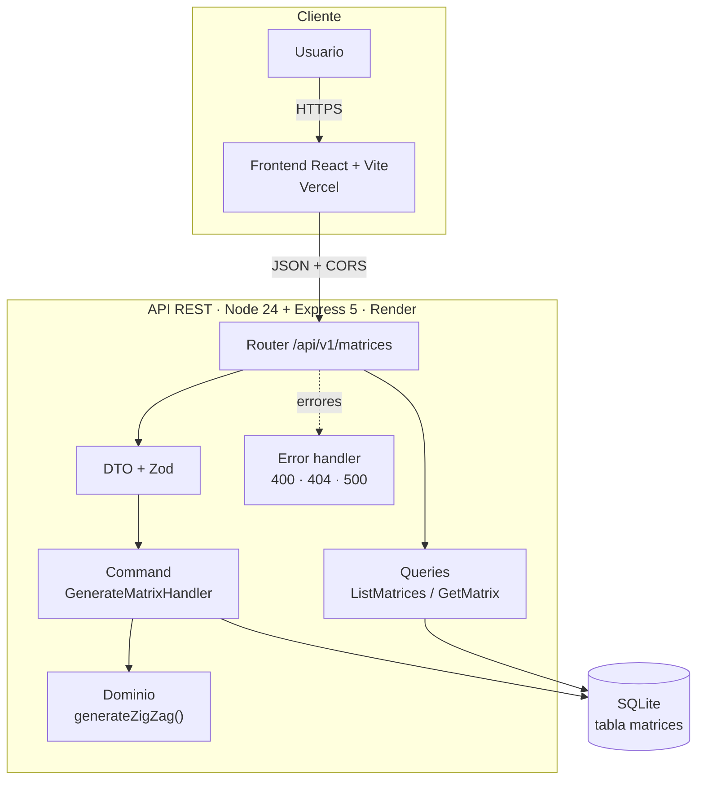
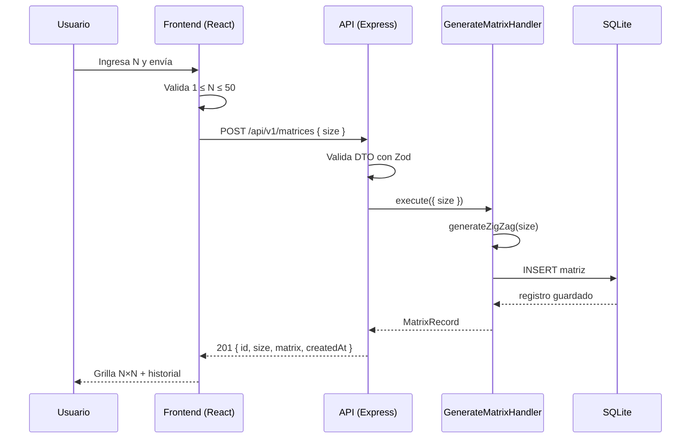

# Prueba Técnica 2 — Matriz N×N en zig zag (Full Stack)

Aplicación full stack que genera matrices **N×N** llenas con los números `1..N²` en zig zag
(serpentina), las persiste y las muestra en una grilla visual.

- **API REST:** Node.js 24 + Express 5 + TypeScript, con CQRS ligero, DTOs validados con Zod y SQLite.
- **Frontend:** React 19 + Vite + TypeScript, con validación en el formulario, grilla e historial (con opción de eliminarlo).
- **Pruebas:** 52 tests (32 backend / 20 frontend) con ~95 % de cobertura.
- **Despliegue:** Render (API) + Vercel (frontend).

| Entorno | URL |
| --- | --- |
| Frontend (Vercel) | _Completar después de desplegar_ |
| API (Render) | _Completar después de desplegar_ |

---

## 1. Cómo funciona el algoritmo

Las filas pares se llenan de izquierda a derecha y las impares de derecha a izquierda,
como en el enunciado. Para `N = 4`:

```
 1 →  2 →  3 →  4
 8 ←  7 ←  6 ←  5
 9 → 10 → 11 → 12
16 ← 15 ← 14 ← 13
```

La lógica vive en una única función pura (`backend/src/domain/matrix.ts`), sin dependencias
de HTTP ni de base de datos, y se prueba de forma aislada.

---

## 2. Estructura del repositorio

```
Prueba-2/
├── backend/
│   ├── src/
│   │   ├── domain/                 # Reglas de negocio puras
│   │   │   ├── matrix.ts           # generateZigZag(), MAX_MATRIX_SIZE
│   │   │   └── errors.ts           # AppError, NotFoundError
│   │   ├── application/            # Casos de uso (CQRS) y contratos
│   │   │   ├── dto.ts              # DTO + validación Zod
│   │   │   ├── commands/           # Escritura: GenerateMatrixHandler
│   │   │   ├── queries/            # Lectura: ListMatricesQuery, GetMatrixQuery
│   │   │   └── ports/              # Interfaz MatrixRepository
│   │   ├── infrastructure/         # Adaptador SQLite
│   │   ├── http/                   # Router, middleware de errores
│   │   ├── app.ts                  # Composición de dependencias
│   │   └── server.ts               # Arranque (puerto, env, BD)
│   ├── test/                       # 31 pruebas (unitarias + integración)
│   ├── .env.example
│   └── package.json
├── frontend/
│   ├── src/
│   │   ├── api/matrices.ts         # Cliente HTTP tipado
│   │   ├── components/             # MatrixForm, MatrixGrid, HistoryList
│   │   ├── App.tsx                 # Estado y composición
│   │   └── styles.css
│   ├── test/                       # 17 pruebas (componentes + API)
│   ├── .env.example
│   └── package.json
├── render.yaml                     # Blueprint de despliegue de la API
└── README.md
```

Capas con dependencias hacia adentro: `http → application → domain`. La infraestructura
implementa el puerto `MatrixRepository` y se inyecta en `app.ts`, por lo que los tests de
integración usan SQLite en memoria y no requieren servicios externos.

---

## 3. API REST

Base URL local: `http://localhost:4000`

| Método | Ruta | Descripción |
| --- | --- | --- |
| `POST` | `/api/v1/matrices` | Genera, persiste y devuelve una matriz N×N |
| `GET` | `/api/v1/matrices?limit=8` | Lista las últimas matrices (máx. 50) |
| `GET` | `/api/v1/matrices/:id` | Devuelve una matriz por id |
| `DELETE` | `/api/v1/matrices` | Vacía el historial (204) |
| `GET` | `/health` | Estado del servicio |

### POST `/api/v1/matrices`

```bash
curl -X POST http://localhost:4000/api/v1/matrices \
  -H "Content-Type: application/json" \
  -d '{"size": 3}'
```

`201 Created`

```json
{
  "id": "5f0d2c3a-9c1e-4b7e-8f0a-2d4c6b8e1a3f",
  "size": 3,
  "matrix": [
    [1, 2, 3],
    [6, 5, 4],
    [7, 8, 9]
  ],
  "createdAt": "2026-10-28T15:00:00.000Z"
}
```

### GET `/api/v1/matrices`

```json
{
  "items": [
    { "id": "...", "size": 3, "matrix": [[1, 2, 3], [6, 5, 4], [7, 8, 9]], "createdAt": "..." }
  ]
}
```

### Validación y errores

El DTO solo acepta `size` como **entero entre 1 y 50** y rechaza propiedades desconocidas.
El límite evita payloads gigantes (N² celdas). El frontend aplica la misma regla antes de
enviar (defensa en profundidad).

| Código HTTP | `error.code` | Cuándo |
| --- | --- | --- |
| 400 | `VALIDATION_ERROR` | `size` ausente, decimal, fuera de rango o campo extra |
| 400 | `INVALID_JSON` | Cuerpo que no es JSON válido |
| 404 | `NOT_FOUND` | Matriz o ruta inexistente |
| 500 | `INTERNAL_ERROR` | Falla inesperada (el detalle se registra en el servidor) |

Formato de error:

```json
{
  "error": {
    "code": "VALIDATION_ERROR",
    "message": "Datos inválidos",
    "details": [{ "path": "size", "message": "El tamaño máximo es 50" }]
  }
}
```

### CQRS

- **Command** (`GenerateMatrixHandler`): valida el DTO, genera la matriz y la guarda.
- **Queries** (`ListMatricesQuery`, `GetMatrixQuery`): solo lectura, sin efectos secundarios.

Se usan handlers explícitos en lugar de un bus de eventos: aporta la separación de
responsabilidades de CQRS sin la infraestructura que un proyecto de este tamaño no necesita.

---

## 4. Arquitectura y despliegue

### Diagrama de componentes



### Flujo de una generación



### Componentes cloud

| Componente | Servicio | Configuración |
| --- | --- | --- |
| Frontend estático | Vercel | Root `frontend`, framework Vite, `VITE_API_URL` |
| API | Render Web Service | Root `backend`, `npm run build`, `npm start`, `CORS_ORIGIN` |
| Base de datos | SQLite en disco de Render | Archivo `backend/data/matrices.db` (o `DATA_DIR`) |

---

## 5. Ejecución local

### Requisitos

- **Node.js 24 o superior** (la API usa el módulo nativo `node:sqlite`).
- npm 11+.

### Backend

```bash
cd backend
npm install
cp .env.example .env      # Windows: copy .env.example .env
npm run dev               # http://localhost:4000
```

Variables de entorno (todas opcionales en local):

| Variable | Default | Descripción |
| --- | --- | --- |
| `PORT` | `4000` | Puerto HTTP |
| `CORS_ORIGIN` | `*` | Origen(es) permitidos, separados por coma |
| `DATA_DIR` | `./data` | Carpeta del archivo SQLite |

### Frontend

```bash
cd frontend
npm install
cp .env.example .env      # Windows: copy .env.example .env
npm run dev               # http://localhost:5173
```

`VITE_API_URL` define la URL de la API. En desarrollo, si no está definida, el cliente
usa rutas relativas (`/api/v1/...`) y Vite las redirige a `http://localhost:4000` con el
proxy de `vite.config.ts` (sin problemas de CORS). En Vercel se define con la URL de Render.

### Base de datos

No requiere instalación ni credenciales. Al arrancar, el adaptador crea el archivo y la tabla:

```sql
CREATE TABLE IF NOT EXISTS matrices (
  id TEXT PRIMARY KEY,
  size INTEGER NOT NULL,
  matrix TEXT NOT NULL,       -- JSON de la matriz
  created_at TEXT NOT NULL
);
```

Para reiniciar los datos en local, borra `backend/data/matrices.db`. Los tests usan una base
en memoria (`:memory:`), por lo que nunca tocan tus datos.

### Si el puerto 4000 está ocupado

Crea `backend/.env` con `PORT=4001` y `frontend/.env` con
`VITE_API_URL=http://localhost:4001`; reinicia ambos servidores. Si el frontend no corre en
el puerto 5173, añade su origen a `CORS_ORIGIN` (separado por comas).

---

## 6. Pruebas

```bash
cd backend && npm test          # 31 tests
cd frontend && npm test         # 17 tests

cd backend && npm run test:coverage
cd frontend && npm run test:coverage
```

| Suite | Qué cubre | Resultado |
| --- | --- | --- |
| Backend · `matrix.test.ts` | Algoritmo: N=1..4, unicidad de 1..N², alternancia de filas | 6 tests |
| Backend · `dto.test.ts` | DTO: rangos, decimales, strings, campos extra | 7 tests |
| Backend · `api.test.ts` | Endpoints, validación, 404, JSON inválido, 500, persistencia, borrado | 19 tests |
| Frontend · `MatrixForm.test.tsx` | Validación del formulario y envío | 9 tests |
| Frontend · `MatrixGrid.test.tsx` | Render de N² celdas y accesibilidad | 1 test |
| Frontend · `HistoryList.test.tsx` | Lista vacía, selección y borrado | 3 tests |
| Frontend · `App.test.tsx` | Flujo completo, error de API y limpieza | 3 tests |
| Frontend · `api.test.ts` | Cliente HTTP: éxito, error de API, sin conexión, DELETE | 4 tests |

Cobertura actual (Vitest + V8): backend **97.6 % statements / 100 % líneas**, frontend
**94 % statements / 96.6 % líneas**.

---

## 7. Despliegue

### 7.1 API en Render

**Opción A — Blueprint (`render.yaml`)**

1. Sube el repositorio a GitHub.
2. En Render: **New → Blueprint**, selecciona el repo y aplica.
3. Define `CORS_ORIGIN` con la URL del frontend (sin `/` final).

**Opción B — Manual**

1. **New → Web Service**, conecta el repo.
2. Root Directory: `backend`.
3. Build Command: `npm ci && npm run build`.
4. Start Command: `npm start`.
5. Health Check Path: `/health`.
6. Variables: `NODE_VERSION=24.21.0` y `CORS_ORIGIN=https://<tu-frontend>.vercel.app`.

> **Persistencia:** en el plan free el disco es efímero y la BD se reinicia en cada deploy.
> Para conservar el historial, usa un plan con disco (descomenta el bloque `disk` de
> `render.yaml` y define `DATA_DIR=/var/data`) o migra a Postgres cambiando solo el
> adaptador de `infrastructure/` (el puerto `MatrixRepository` no cambia).
>
> El plan free también suspende el servicio por inactividad: la primera petición puede
> tardar ~50 s.

### 7.2 Frontend en Vercel

1. **Add New → Project** e importa el repositorio.
2. Root Directory: `frontend` (Vercel detecta Vite con `vercel.json`).
3. Variable de entorno: `VITE_API_URL=https://<tu-api>.onrender.com`.
4. Deploy.

Las variables de Vite se fijan en build: si cambias `VITE_API_URL`, vuelve a desplegar.

### 7.3 Verificación posterior

```bash
curl https://<tu-api>.onrender.com/health
curl -X POST https://<tu-api>.onrender.com/api/v1/matrices \
  -H "Content-Type: application/json" -d '{"size": 3}'
```

Abre el frontend, genera una matriz y confirma que el historial se llena (API ↔ frontend ↔ BD).

---

## 8. Decisiones y limitaciones

- **CQRS sin sobreingeniería:** commands y queries separados, sin bus ni event sourcing.
- **Validación en dos capas:** el formulario evita peticiones inválidas; la API no confía en el cliente.
- **SQLite nativo:** cero dependencias binarias, ideal para demo; el puerto permite cambiar de motor.
- **Límite N ≤ 50:** acota el payload (2 500 celdas) y el tiempo de cómputo.
- **Sin autenticación ni rate limiting:** fuera del alcance de la prueba; la API es de solo demo.
- **Historial sin paginación:** devuelve las últimas 50 como máximo.

### Mejoras posibles

Postgres gestionado, CI con GitHub Actions, rate limiting, autenticación y paginación del historial.
